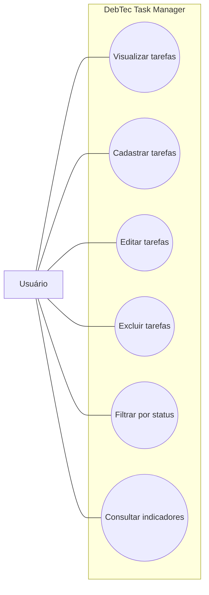

# Diagrama de Casos de Uso — DebTec Task Manager

## Objetivo
O diagrama apresenta as principais funções do DebTec Task Manager e mostra como o usuário pode interagir com o sistema para organizar suas tarefas.

# Ator principal
Usuário: é a pessoa que utiliza o sistema para cadastrar, visualizar, editar e excluir tarefas.

# Diagrama

# Descrição das funcionalidades

Visualizar tarefas: permite consultar as tarefas cadastradas.

Cadastrar tarefas: permite adicionar novas tarefas ao sistema.

Editar tarefas: permite modificar as informações de uma tarefa.

Excluir tarefas: permite remover tarefas cadastradas.

Filtrar por status: facilita a busca de tarefas de acordo com seu andamento.

Consultar indicadores: mostra a quantidade de tarefas e seus respectivos status.
